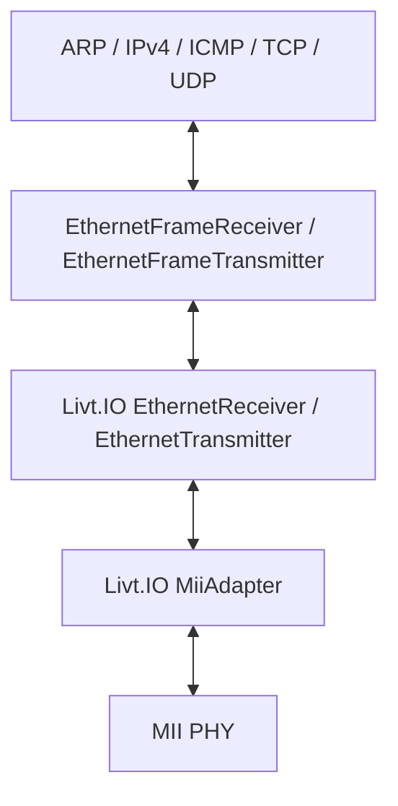

# Using the Livt.IO MAC with MII

The existing `Livt.Net.Drivers.Ethernet` adapters support the Livt.IO MAC over
MII without polling a hardware register window:



`EthernetFrameReceiver` borrows the MAC receive slot without another frame copy.
`EthernetFrameTransmitter<S>` borrows a prepared `IPacketData` source until its
copy into the MAC and wire completion have finished. The caller acknowledges
completion before reuse. The PHY manager, pin interface, and clock crossings
belong to Livt.IO and the board; Livt.Net owns frame and protocol abstractions.

Use these registry dependencies in a consumer that constructs the IO components:

```toml
[dependencies]
"Livt.Net" = "1.3.1"
"Livt.IO" = "1.4.0"
```

Publish Livt.IO 1.4.0 before Livt.Net 1.3.1. Existing Net frame/protocol APIs are
unchanged. See [frame adapter construction](ethernet.md) for the MAC-to-Net wiring.

The normal package test catalog includes `MiiFrameTest` and `MiiFrame10Test`.
Their sources and helper components live under `tests/`. They verify a complete
frame, FCS validation, byte contents, and receive/transmit ownership release
at both 10 and 100 Mb/s. Both cases pass in simulation; board timing and hardware
operation require separate validation.

```sh
livt sync
livt test -R -r MiiFrameTest
livt test -R -r MiiFrame10Test
```

No video dependencies are introduced into Livt.Net.
